<div align="center">

# HDFS Incident Radar

**Classifying anomalous HDFS blocks from completed log-event histories.**


</div>

## Project Overview

Distributed file systems produce more log messages than an engineer can readily inspect. HDFS Incident Radar groups completed log histories by block and uses event counts to classify each block as normal or anomalous. The analysis explores which event patterns distinguish the two classes and compares familiar machine learning models on a heavily imbalanced benchmark.

The project is a retrospective classification study. It does not perform real-time monitoring, predict failures before they occur, or establish the cause of an incident.

## Project Objectives

- Prepare and explore labelled HDFS block-event data while excluding fields that reveal the answer.
- Compare interpretable classifiers and investigate event patterns using PCA and k-means.
- Evaluate unfamiliar event-count patterns with metrics that reflect missed anomalies and false alarms.
- Present the analysis through a static interactive dashboard.

## Dataset

The [Loghub HDFS_v1 dataset](https://zenodo.org/records/8196385) supplies the event-count matrix and block labels. Each row represents one HDFS block.

| | Dataset |
|:--|--:|
| Total blocks | 575,061 |
| Normal | 558,223 (97.07%) |
| Anomalous | 16,838 (2.93%) |
| Original event-count features | 29 (`E1`–`E29`) |
| Final model features | 28 |
| Target | `0` normal · `1` anomaly |

Block IDs, labels and the label-revealing `Type` field are excluded from the features. `E22` is constant in the training data and is removed. Scaling is fitted on training data only where required; the original block records are retained.

## Machine Learning Workflow

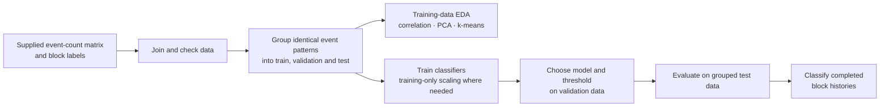

## Exploratory Data Analysis

The class distribution shows why accuracy alone is insufficient. Event correlations and distributions describe the training data, while PCA and k-means give a compact view of its structure. The k-means elbow is gradual; **k = 4** is an illustrative choice for exploration.

<p align="center">
  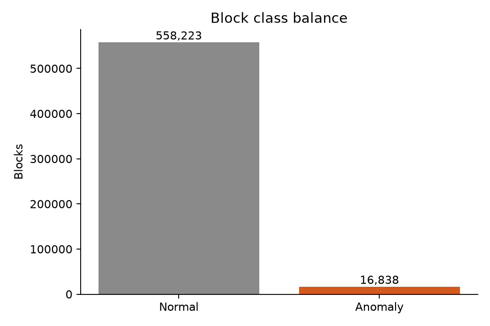
  
</p>
<p align="center">
  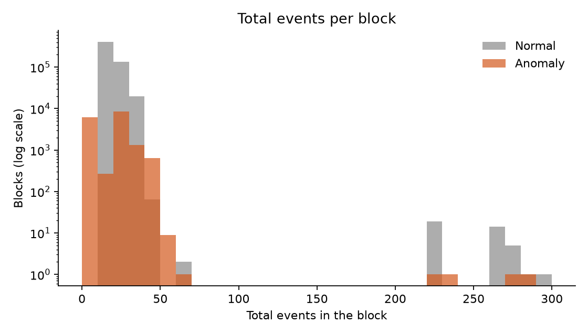
  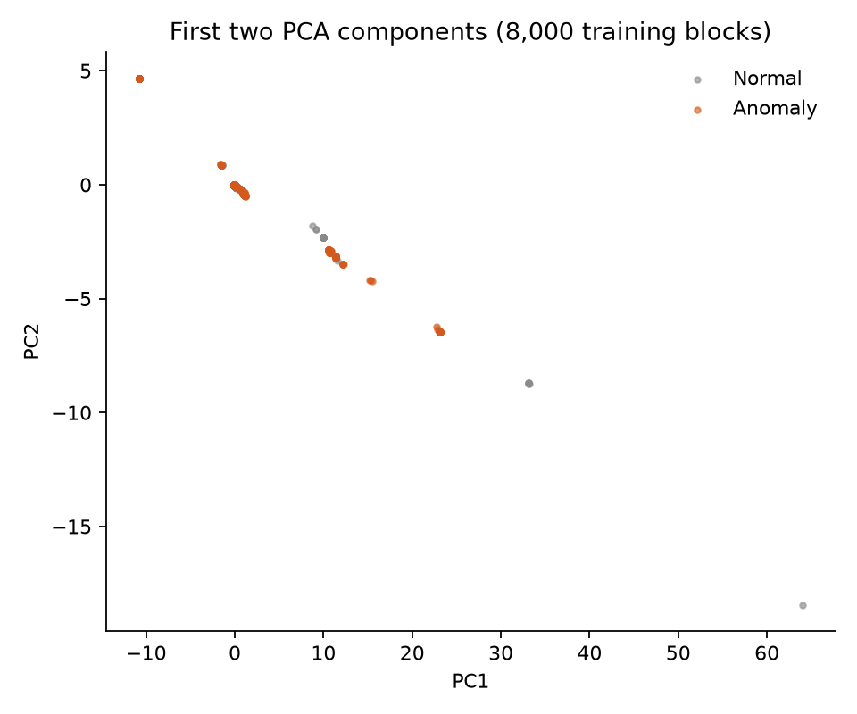
</p>
<p align="center">
  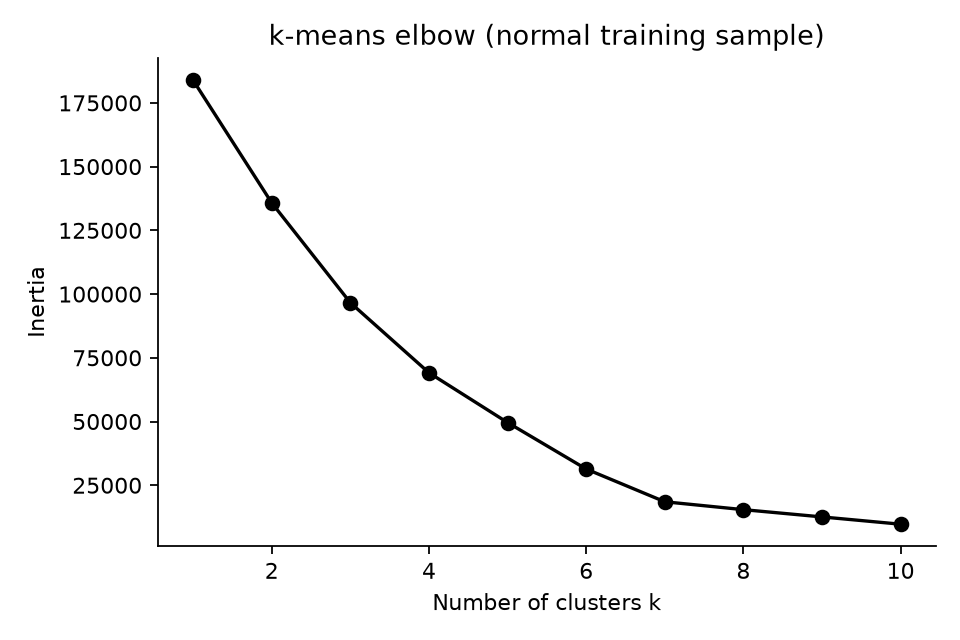
  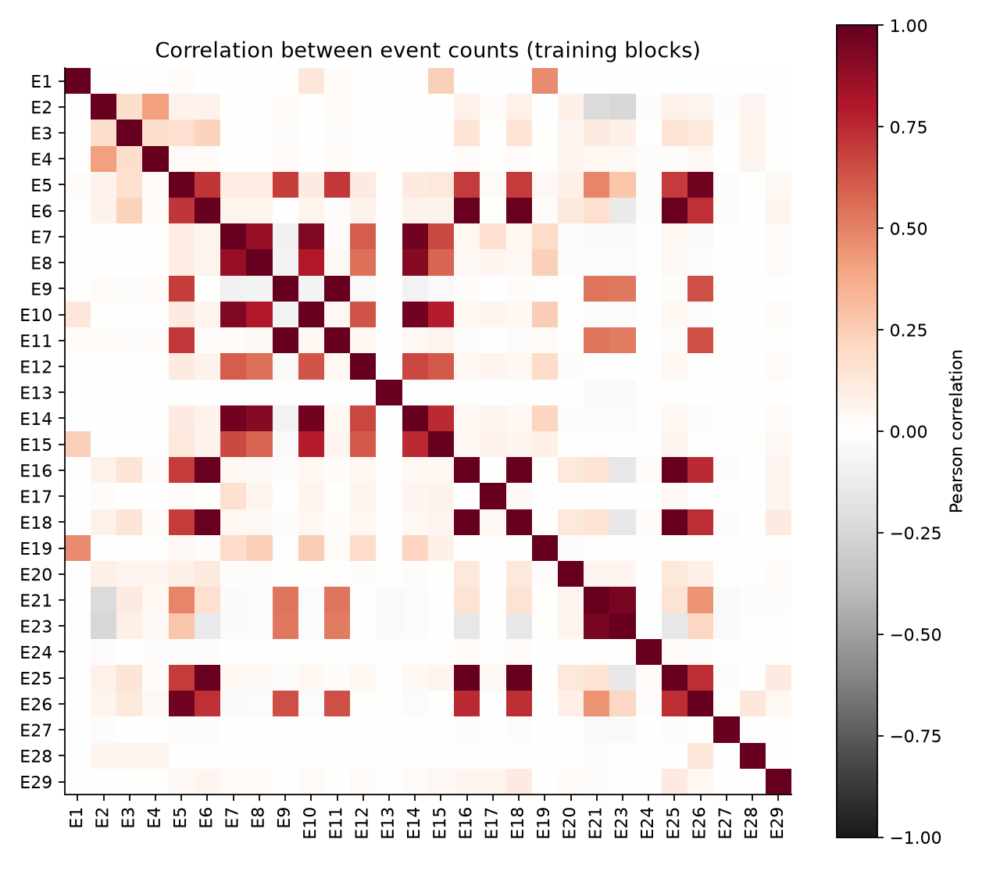
</p>

## Machine Learning Models

| Role | Models | Purpose |
|:--|:--|:--|
| Primary classifiers | Logistic regression, decision tree, k-nearest neighbours, random forest | Compare linear, rule-based, similarity-based and ensemble approaches. |
| Baseline | Always-normal classifier | Illustrate the effect of class imbalance. |
| Exploratory | PCA and k-means | Summarise variation and describe groups in the training data. |
| Supplementary | PCA anomaly detector, weighted logistic regression, Naive Bayes, linear SVM, AdaBoost and MLP | Provide additional comparisons. |

## Model Performance

**Logistic regression** was selected from the four primary classifiers using validation cost. Its grouped test results are:

| Evaluation metric | Result |
|:--|--:|
| Accuracy | 99.9800% |
| Precision | 99.9701% |
| Recall | 99.3468% |
| F1 score | 99.6575% |
| ROC-AUC | 0.999398 |

The selected model identified **3,346 of 3,368** anomalous test blocks, with **22 missed anomalies** and **1 false alarm**. The comparison below reports validation cost for all primary models; only the three selected on validation were evaluated on the grouped test set.

| Primary classifier | Validation cost ↓ | Validation F1 | Grouped test F1 |
|:--|--:|--:|--:|
| Logistic regression | **4** | 0.9994 | 0.9966 |
| k-nearest neighbours | 12 | 0.9982 | 0.9990 |
| Decision tree | 18 | 0.9987 | 0.9988 |
| Random forest | 32 | 0.9993 | — |

<p align="center">
  
  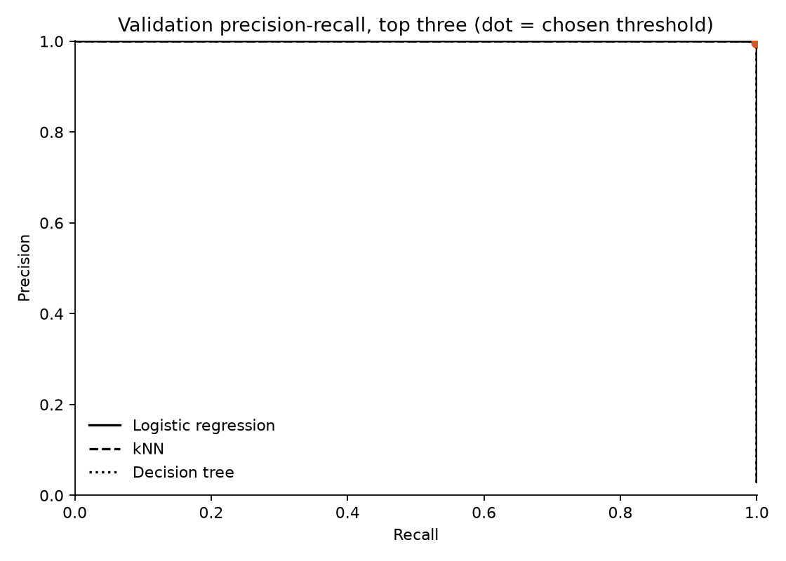
</p>

<p align="center">
  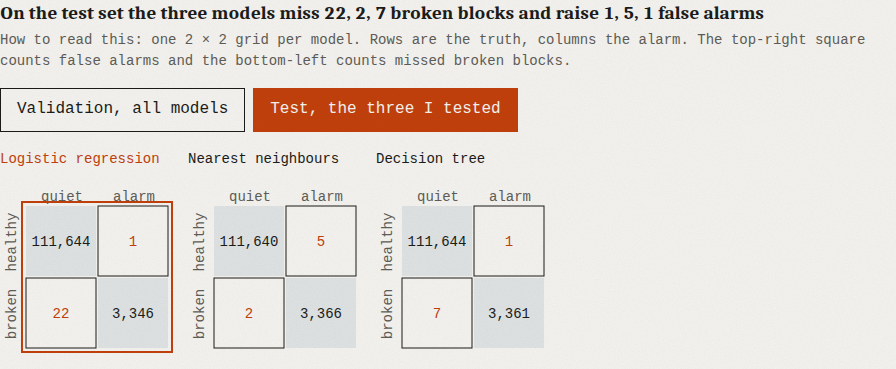
</p>

Full metrics and confusion counts: [validation comparison](reports/tables/model_comparison.csv) · [grouped test results](reports/tables/final_test_results.csv).

## Evaluation Methodology

Identical event-count vectors are assigned to the same partition, with **zero shared feature patterns** between training, validation and test. Training-only preprocessing is followed by model and threshold selection on validation data. The cost `10 × false negatives + false positives` is a project assumption, not a measured operational cost.

A [conventional stratified row split](reports/tables/stratified_final_test_results.csv) is retained as a historical comparison; it measures new blocks from the same distribution, whereas the grouped split tests unseen count patterns. The grouped test results have already been inspected and the test was evaluated twice during development. The recorded model choices and thresholds were based on the project requirements and validation results. Results apply to this benchmark and do not establish performance on other systems.

## Interactive Dashboard

The existing [dashboard source](docs/index.html) presents the saved analysis with an interactive threshold, model comparisons and exploratory charts. It displays precomputed results rather than making live predictions.

<p align="center">
  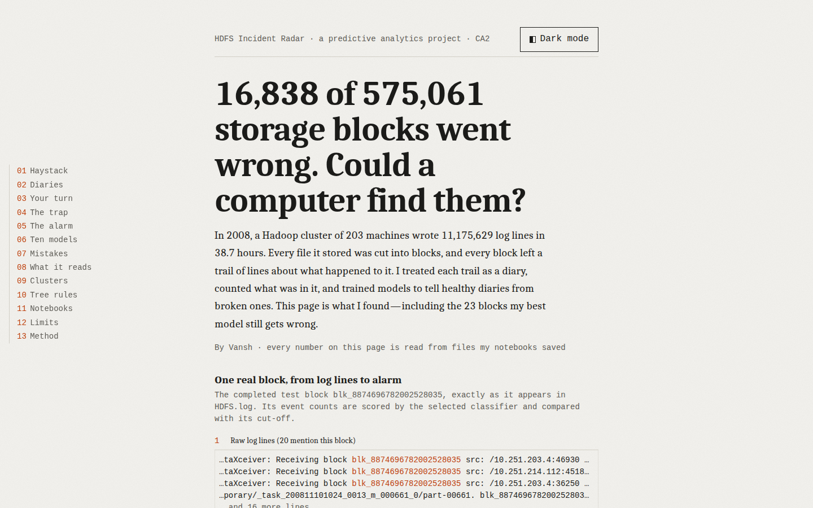
  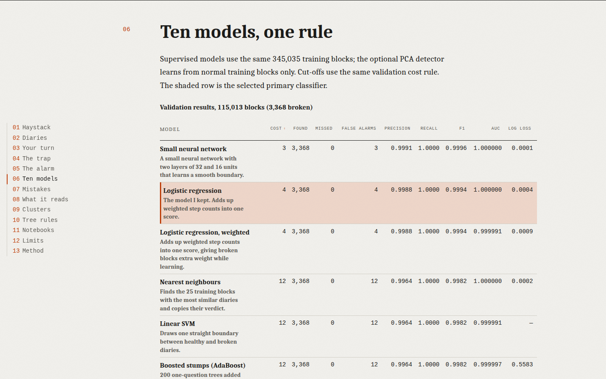
</p>
<p align="center">
  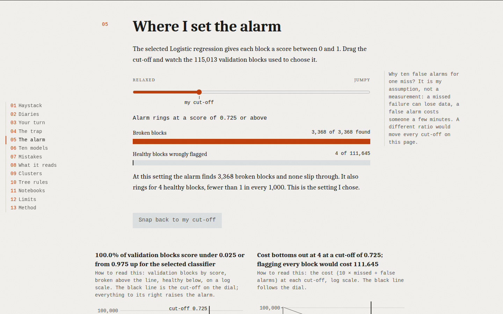
  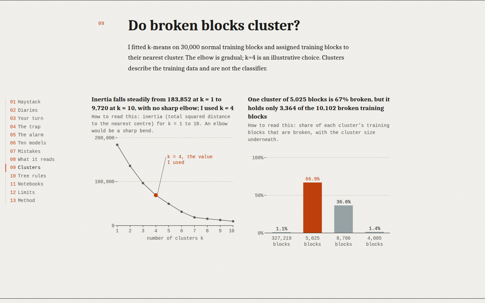
</p>

## Technology Stack

Python · pandas · NumPy · scikit-learn · Matplotlib · Jupyter · HTML, CSS and JavaScript

## Academic Context

| | |
|:--|:--|
| Course | INT234 — Predictive Analytics |
| Programme | B.Tech Computer Science and Engineering |
| Academic level | Third Year |
| Domain | Data Science and Machine Learning |
| Application | Distributed Systems Anomaly Classification |

The [original proposal](HDFS_Incident_Radar.pdf) and the existing project report PDF are historical and contain outdated descriptions or results. The notebooks and tables contain the current analysis.

## Run Locally

To view the precomputed dashboard, run from the repository root:

```bash
cd docs && python3 -m http.server 8000
```

Open `http://localhost:8000`, or open `docs/preview.html` directly for the offline version.

## Author

**Vansh**
