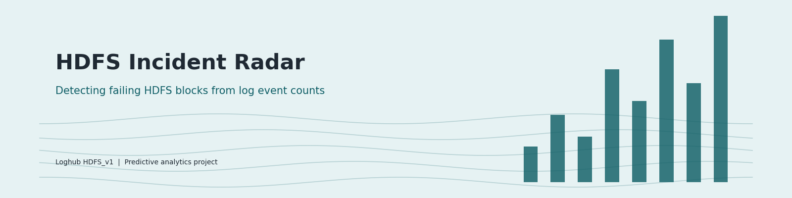
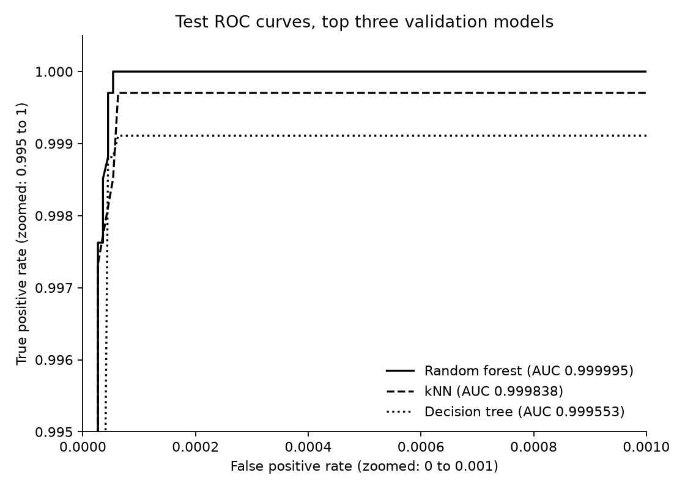
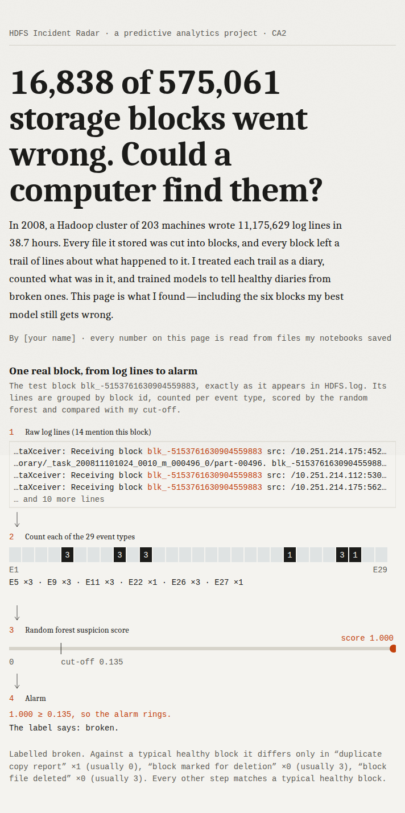
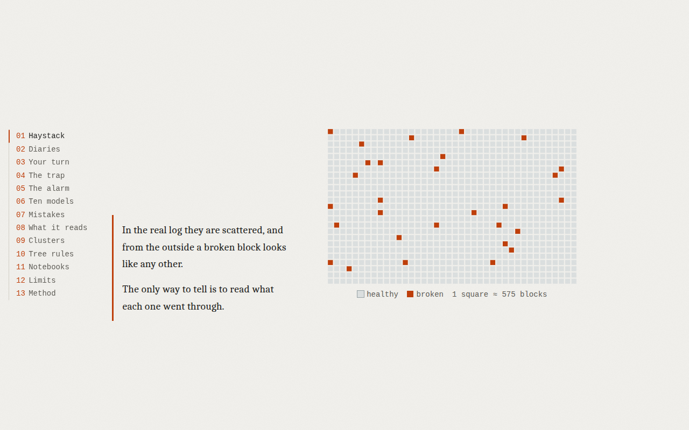
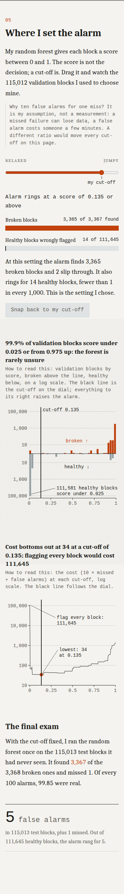
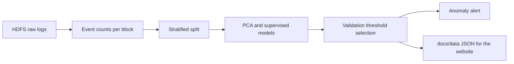

<p align="center">
  
</p>

<h1 align="center">HDFS Incident Radar</h1>

<p align="center">Detecting failing HDFS blocks from log event counts.</p>

<p align="center">
  
  
  
  
  
</p>

<p align="center">
  <!-- TODO replace with the GitHub Pages URL --><a href="[live website link]"></a>
  <!-- TODO replace with real URL -->
  <!-- TODO replace with real URL -->
</p>

## Table of contents

- [Overview](#overview)
- [Key results](#key-results)
- [Screenshots](#screenshots)
- [How it works](#how-it-works)
- [Dataset](#dataset)
- [Methodology](#methodology)
- [Repository structure](#repository-structure)
- [Getting started](#getting-started)
- [Limitations](#limitations)
- [Roadmap](#roadmap)
- [Acknowledgements and citation](#acknowledgements-and-citation)
- [Author](#author)

## Overview

Distributed systems write large volumes of logs that engineers cannot read manually during an incident. This project treats each HDFS block as one observation and uses its counts of log-event types as input features. It predicts whether a labelled block is normal or anomalous. The work compares PCA-based anomaly detection with linear, tree-based, neighbour-based, probabilistic, SVM, boosting, and neural-network models. It also selects an alarm threshold using the relative cost of missed failures and false alarms.

## Key results

Final results below are taken directly from [`reports/tables/final_test_results.csv`](reports/tables/final_test_results.csv). The three models with the lowest validation cost (10 × missed anomalies + false alarms) were scored once on the 115,013-block test set, at thresholds chosen on validation data.

| Model | Threshold | Precision | Recall | F1 | AUC | Log loss | Found (TP) | Missed (FN) | False alarms (FP) |
|---|---:|---:|---:|---:|---:|---:|---:|---:|---:|
| Random forest | 0.135 | 0.998517 | 0.999703 | 0.999110 | 0.999995 | 0.000508 | 3,367 | 1 | 5 |
| kNN (k = 5) | 0.205 | 0.997925 | 0.999703 | 0.998813 | 0.999838 | 0.001335 | 3,367 | 1 | 7 |
| Decision tree (depth 12) | 0.030 | 0.997924 | 0.999109 | 0.998516 | 0.999553 | 0.001207 | 3,365 | 3 | 7 |

The always-normal baseline is 97.07% accurate on the same test set and finds none of the 3,368 broken blocks. Validation results for all eleven rows (ten models and the baseline) are in [`reports/tables/model_comparison.csv`](reports/tables/model_comparison.csv), and every hyperparameter is in [`reports/tables/model_settings.csv`](reports/tables/model_settings.csv).

**Live website:** [live website link] (an interactive explainer built from these results; source in [`docs/`](docs/)).

<p align="center">
  
  
  
</p>

Class balance shows why accuracy cannot stand alone. Event-label correlation summarises useful count patterns, and the ROC curves compare validation-selected models on the untouched test set.

## Screenshots

The website in [`docs/`](docs/) draws every chart from the saved results (more in [`reports/website_screenshots/`](reports/website_screenshots/)).

<p align="center">
  
  
  
</p>

## How it works



## Dataset

The project uses Loghub HDFS_v1 from [Zenodo record 8196385](https://zenodo.org/records/8196385): 575,061 labelled blocks, including 558,223 normal and 16,838 anomalous blocks. The dataset is not included in this repository.

On Linux, download and extract it into `datasets/`:

```bash
mkdir -p datasets
curl -L "https://zenodo.org/records/8196385/files/HDFS_v1.zip?download=1" -o datasets/HDFS_v1.zip
unzip datasets/HDFS_v1.zip -d datasets/hdfs_v1
```

The notebooks expect preprocessed files under `datasets/hdfs_v1/preprocessed/`, including `anomaly_label.csv`, `Event_occurrence_matrix.csv`, and `HDFS.log_templates.csv`.

## Methodology

<details>
<summary>Preprocessing and validation</summary>

Only `E1` to `E29` event-count fields are used as model features. Block identifiers, labels, and non-event fields are excluded. A single stratified 80/20 train/test split uses `random_state=42`; the training portion is split again into training and validation sets. The test set is used only for final reporting.

</details>

<details>
<summary>Models, metrics, and threshold</summary>

The comparison includes an always-normal baseline, a PCA reconstruction-error detector (fitted on normal training blocks only), logistic regression with and without balanced class weights, a decision tree (depth chosen by a bias-variance sweep), kNN (k chosen from 5, 15 and 25), Gaussian Naive Bayes, linear SVM, random forest, AdaBoost, and a small MLP. Metrics are accuracy, precision, recall, F1, AUC, log loss, and confusion-matrix counts. A false negative is assigned a cost 10 times that of a false positive. On validation data, every distinct score of each model (plus a 201-point grid) is tried as a threshold, and a block raises the alarm when its score is at or above the threshold; the same rule is used for evaluation. Notebook 03 ends with leakage checks.

</details>

## Repository structure

```text
.
├── docs/                 Website (index.html, css/, js/, data/), preview.html, notes, assets
├── notebooks/            01 cleaning and split, 02 EDA, 03 models and evaluation
├── reports/
│   ├── figures/          Saved charts used in analysis and reporting
│   └── tables/           Validation, test, settings and EDA tables
├── src/
│   ├── export_web_data.py   Writes docs/data/*.json from the saved results
│   ├── build_preview.py     Writes docs/preview.html (single file, opens offline)
│   └── make_social_image.py Draws docs/assets/social_preview.png from the haystack grid
├── LICENSE               MIT licence
├── CITATION.cff          Citation metadata
└── requirements.txt      Python dependencies (pinned)
```

## Getting started

```bash
git clone https://github.com/Vanshr45/hdfs-incident-radar.git
cd hdfs-incident-radar
python3 -m venv .venv
source .venv/bin/activate
python -m pip install -r requirements.txt
```

Download the dataset as described above, then run the notebooks in order: `01_cleaning_and_visualization.ipynb` (creates `datasets/processed/hdfs_clean.csv` and `splits.npz`), `02_eda_and_statistical_analysis.ipynb`, and `03_model_development_and_evaluation.ipynb` (trains every model and saves the tables, figures and `models/best_final_model.pkl`). All split-dependent work uses `random_state=42`.

```bash
for nb in notebooks/0*.ipynb; do jupyter nbconvert --to notebook --execute --inplace "$nb"; done
```

### Rebuilding the website data

The website never trains anything; it only shows saved results. After the notebooks have run:

```bash
python src/export_web_data.py   # writes docs/data/*.json (incl. charts.json) and docs/assets/figures/, printing every number
python src/build_preview.py     # writes docs/preview.html, a single file that opens by double-click
python src/make_social_image.py  # redraws docs/assets/social_preview.png (1200 x 630) from facts.json
```

To view the site locally:

```bash
cd docs && python -m http.server 8000   # then open http://localhost:8000
```

## Limitations

This is one labelled benchmark dataset from one distributed system, and the labels came from hand-written rules, so the models learned to agree with those rules. Event counts ignore the order of events. A threshold chosen with the assumed 10:1 missed-failure cost may not match another operational setting. Event counts describe patterns associated with known labels; they do not identify the root cause of an incident.

## Roadmap

The static website in [`docs/`](docs/) is published with GitHub Pages (Settings → Pages → deploy from the `main` branch, `/docs` folder). Possible next steps are adding event order (sequence features) and testing on a second log dataset.

## Acknowledgements and citation

The HDFS_v1 dataset is provided by [Loghub](https://github.com/logpai/loghub). This project also acknowledges the original HDFS log-analysis work by Xu et al. See [`CITATION.cff`](CITATION.cff) for repository citation metadata.

## Author

Vansh Rana · [GitHub](https://github.com/Vanshr45)
