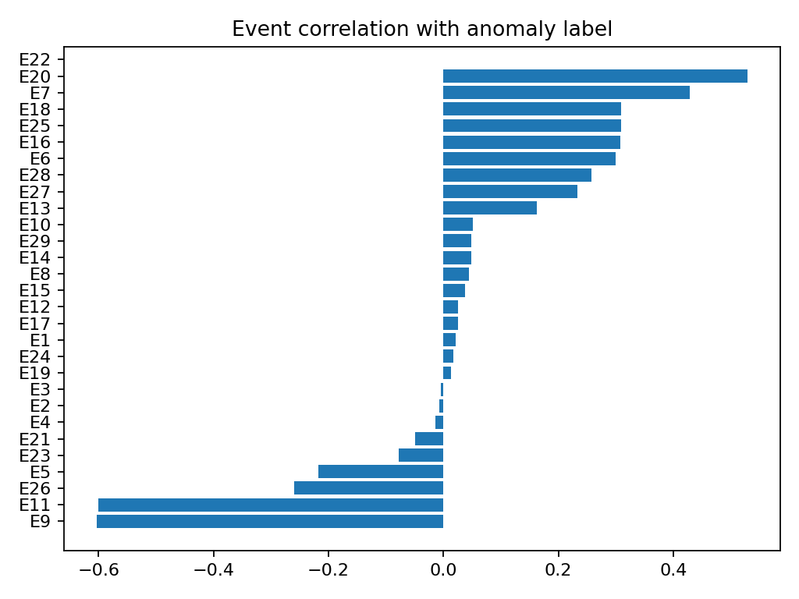
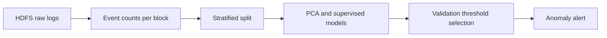

<p align="center">
  
</p>

<h1 align="center">HDFS Incident Radar</h1>

<p align="center">Detecting failing HDFS blocks from log event counts.</p>

<p align="center">
  
  
  
  
  
</p>

<p align="center">
  <!-- TODO replace with real URL -->
  <!-- TODO replace with real URL -->
  <!-- TODO replace with real URL -->
</p>

## Table of contents

- [Overview](#overview)
- [Key results](#key-results)
- [How it works](#how-it-works)
- [Dataset](#dataset)
- [Methodology](#methodology)
- [Repository structure](#repository-structure)
- [Getting started](#getting-started)
- [Limitations](#limitations)
- [Roadmap](#roadmap)
- [Acknowledgements and citation](#acknowledgements-and-citation)
- [Author](#author)

## Overview

Distributed systems write large volumes of logs that engineers cannot read manually during an incident. This project treats each HDFS block as one observation and uses its counts of log-event types as input features. It predicts whether a labelled block is normal or anomalous. The work compares PCA-based anomaly detection with linear, tree-based, neighbour-based, probabilistic, SVM, boosting, and neural-network models. It also selects an alarm threshold using the relative cost of missed failures and false alarms.

## Key results

Final results below are taken directly from [`reports/tables/final_test_results.csv`](reports/tables/final_test_results.csv). Thresholds were selected on validation data before this final test evaluation.

| Model | Precision | Recall | F1 | AUC | Log loss |
|---|---:|---:|---:|---:|---:|
| Random forest | 0.981341 | 0.999406 | 0.990291 | 0.999945 | 0.092249 |
| MLP | 0.976764 | 0.998515 | 0.987520 | 0.999734 | 0.000722 |
| Logistic regression, balanced | 0.965310 | 0.999703 | 0.982205 | 0.999691 | 0.005894 |

<p align="center">
  
  
  
</p>

Class balance shows why accuracy cannot stand alone. Event-label correlation summarises useful count patterns, and the ROC curves compare validation-selected models on the untouched test set.

## How it works



## Dataset

The project uses Loghub HDFS_v1 from [Zenodo record 8196385](https://zenodo.org/records/8196385): 575,061 labelled blocks, including 558,223 normal and 16,838 anomalous blocks. The dataset is not included in this repository.

On Linux, download and extract it into `datasets/`:

```bash
mkdir -p datasets
curl -L "https://zenodo.org/records/8196385/files/HDFS_v1.zip?download=1" -o datasets/HDFS_v1.zip
unzip datasets/HDFS_v1.zip -d datasets/hdfs_v1
```

The notebooks expect preprocessed files under `datasets/hdfs_v1/preprocessed/`, including `anomaly_label.csv`, `Event_occurrence_matrix.csv`, and `HDFS.log_templates.csv`.

## Methodology

<details>
<summary>Preprocessing and validation</summary>

Only `E1` to `E29` event-count fields are used as model features. Block identifiers, labels, and non-event fields are excluded. A single stratified 80/20 train/test split uses `random_state=42`; the training portion is split again into training and validation sets. The test set is used only for final reporting.

</details>

<details>
<summary>Models, metrics, and threshold</summary>

The comparison includes a PCA reconstruction-error detector, logistic regression with and without balanced class weights, decision tree, kNN, Gaussian Naive Bayes, linear SVM, random forest, AdaBoost, and MLP. Metrics are accuracy, precision, recall, F1, AUC, log loss, and confusion-matrix counts. A false negative is assigned a cost 10 times that of a false positive; validation data selects the alarm threshold.

</details>

## Repository structure

```text
.
├── docs/                 Project notes, citation, assets, and report placeholder
├── notebooks/            Cleaning, EDA, and model-evaluation notebooks
├── reports/
│   ├── figures/          Saved charts used in analysis and reporting
│   ├── tables/           Saved validation and final-test result tables
│   └── web_data/         Compact JSON data for a future static website
├── src/                  Reserved for reusable source code
├── LICENSE               MIT licence
├── CITATION.cff          Citation metadata
└── requirements.txt      Python dependencies
```

## Getting started

```bash
git clone https://github.com/Vanshr45/hdfs-incident-radar.git
cd hdfs-incident-radar
python3 -m venv .venv
source .venv/bin/activate
python -m pip install -r requirements.txt
```

Download the dataset as described above, then start Jupyter and run the notebooks in order: `01_cleaning_and_visualization.ipynb`, `02_eda_and_statistical_analysis.ipynb`, and `03_model_development_and_evaluation.ipynb`. All split-dependent work uses `random_state=42`.

## Limitations

This is one labelled benchmark dataset from one distributed system. A threshold chosen with the assumed 10:1 missed-failure cost may not match another operational setting. Event counts describe patterns associated with known labels; they do not identify the root cause of an incident.

## Roadmap

The planned next step is a static public website hosted with GitHub Pages. It will use the compact files in `reports/web_data/`.

## Acknowledgements and citation

The HDFS_v1 dataset is provided by [Loghub](https://github.com/logpai/loghub). This project also acknowledges the original HDFS log-analysis work by Xu et al. See [`CITATION.cff`](CITATION.cff) for repository citation metadata.

## Author

Vansh Rana · [GitHub](https://github.com/Vanshr45)
